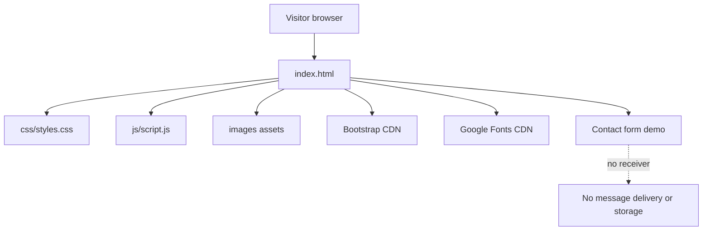

<div align="center">

# ☕ Café Delight

### A responsive static café landing-page concept

[](https://developer.mozilla.org/docs/Web/HTML)
[](https://developer.mozilla.org/docs/Web/CSS)
[](https://developer.mozilla.org/docs/Web/JavaScript)
[](https://getbootstrap.com/)
[](LICENSE)

**[📚 Documentation](docs/README.md) · [🚀 Setup](docs/installation.md) · [🧪 Testing](docs/testing.md) · [🤝 Contributing](CONTRIBUTING.md)**

</div>

> [!IMPORTANT]
> This is a front-end demonstration. It has no ordering, booking, payment, customer account, backend, database, or working contact-message delivery. Branch details and testimonials are sample content and must be verified before being represented as real.

## 🌟 Project overview

Café Delight is a single-page café website concept built with semantic HTML, custom CSS, Bootstrap components, and vanilla JavaScript. It demonstrates a typical small-business landing page: navigation, hero, about, menu, branch information, testimonials, and a contact section.

### ✨ Included sections

| Section | Purpose |
|---|---|
| Navigation | Jump between page sections, with responsive Bootstrap menu |
| Hero | Café background and primary welcome message |
| About | Short business introduction |
| Menu | Coffee, pastry, and sandwich sample cards |
| Branches | Example location cards |
| Testimonials | Bootstrap carousel with sample quotes |
| Contact | Form layout clearly marked as demonstration only |
| Footer | Basic site identity |

## 🧱 Technology

- **HTML5:** semantic document and page sections.
- **CSS3:** responsive layout, cards, focus states, reduced-motion support.
- **Bootstrap 5.3.0-alpha1:** grid, navbar, carousel, and utility classes.
- **Vanilla JavaScript:** in-page navigation enhancement and mobile menu close.
- **Google Fonts:** Roboto typeface.
- **Static hosting:** no build step or server-side runtime required.

The Bootstrap CDN currently points to an alpha release. Upgrade to a reviewed stable version before production use.

## 🗺️ Architecture



## 🗂️ Repository structure

```text
CAFE-WEBSITE/
├── .github/                  # Issue, PR, discussion templates and CI
├── css/styles.css            # Responsive custom styles
├── data/                     # Content/data policy
├── docs/                     # Project, architecture, security, testing guides
│   ├── assets/                # SVG diagrams
│   ├── decisions/             # Architecture decision records
│   ├── reports/               # Review report area
│   └── templates/             # Reusable project templates
├── examples/                 # Isolated examples guidance
├── images/                   # Café and menu imagery
├── js/script.js              # Navigation enhancement
├── index.html                # Main page
├── image.png                 # Additional unreferenced image asset
├── CHANGELOG.md
├── CODE_OF_CONDUCT.md
├── CONTRIBUTING.md
├── LICENSE
├── Makefile
├── README.md
├── ROADMAP.md
├── SECURITY.md
└── SUPPORT.md
```

See [Project Structure](docs/project-structure.md) for detailed responsibilities.

## 🚀 Run locally

### Requirements
- Modern browser.
- Python 3 or another static HTTP server.
- Network access for current Bootstrap and Google Fonts CDN resources.

No npm install, build command, Node.js server, or database is needed.

```bash
git clone https://github.com/Brajesh31/CAFE-WEBSITE.git
cd CAFE-WEBSITE
python -m http.server 8000
```

Open http://localhost:8000. Stop the server with Ctrl+C.

## 🧪 Quality checks

The project has a GitHub Actions workflow that checks local resource references and whitespace. Browser-level testing remains a manual task. Test:
- Navbar expand/collapse and section navigation.
- Carousel previous/next controls.
- Mobile widths and horizontal overflow.
- Keyboard focus and reduced-motion behavior.
- Image loading and console/network errors.
- The contact section's explicit demo-only state.

Do not claim a browser compatibility or accessibility audit unless it has actually been performed. Use the [test report template](docs/templates/test-report-template.md).

## 🔐 Privacy and security boundaries

The contact form is intentionally non-submitting and its submit control is disabled. No message is sent or stored. Do not enter real personal information into a static demo. The page loads third-party CDN resources, so the browser makes requests to those providers.

Never commit credentials, visitor data, or private messages. Review [SECURITY.md](SECURITY.md) and [Privacy](docs/privacy.md) before adding any integration.

## 📚 Documentation

| Guide | What it covers |
|---|---|
| [Documentation hub](docs/README.md) | Complete index |
| [Project overview](docs/project-overview.md) | Scope and feature inventory |
| [Architecture](docs/architecture.md) | Browser, assets, dependencies |
| [Design system](docs/design-system.md) | Visual conventions |
| [Accessibility](docs/accessibility.md) | Keyboard, semantics, contrast |
| [Content guide](docs/content-guide.md) | Menu, branch, testimonial, image verification |
| [Installation](docs/installation.md) | Local setup |
| [Development](docs/development.md) | Working practices |
| [Deployment](docs/deployment.md) | Static hosting |
| [Known issues](docs/known-issues.md) | Remaining gaps |
| [Testing](docs/testing.md) | Test strategy |
| [Security](docs/security.md) | Threat boundaries |
| [Privacy](docs/privacy.md) | Data handling |
| [SEO](docs/seo.md) | Metadata guidance |
| [Performance](docs/performance.md) | Asset optimization |
| [Maintenance](docs/maintenance.md) | Routine upkeep |
| [Release process](docs/release-process.md) | Publication checklist |
| [API and database](docs/api.md) · [Database](docs/database.md) | Explicit current non-use |
| [FAQ](docs/faq.md) · [Troubleshooting](docs/troubleshooting.md) | Common issues |

## 🛣️ Roadmap

- [x] Correct stylesheet and image paths.
- [x] Load local navigation enhancement.
- [x] Constrain menu images to their cards.
- [x] Improve focus visibility and reduced-motion behavior.
- [x] Make demo-only contact status explicit.
- [ ] Upgrade Bootstrap to a stable, reviewed version.
- [ ] Verify business details, testimonials, and image licenses.
- [ ] Add browser automation only if the project needs it.
- [ ] Add a real contact receiver only with explicit privacy and security design.

## 🤝 Contributing

Read [CONTRIBUTING.md](CONTRIBUTING.md), follow the [Code of Conduct](CODE_OF_CONDUCT.md), and submit a focused pull request with screenshots for visual changes and actual test evidence.

## 📄 License and asset attribution

The repository code is distributed under the MIT License. Image and font rights must be checked separately. The repository currently does not record provenance for the bundled café images, so do not assume the MIT license covers them.

## 👨‍💻 Maintainer

Brajesh Kumar · [GitHub @brajesh31](https://github.com/brajesh31)

Last updated: 2026-11-16 22:29 UTC
